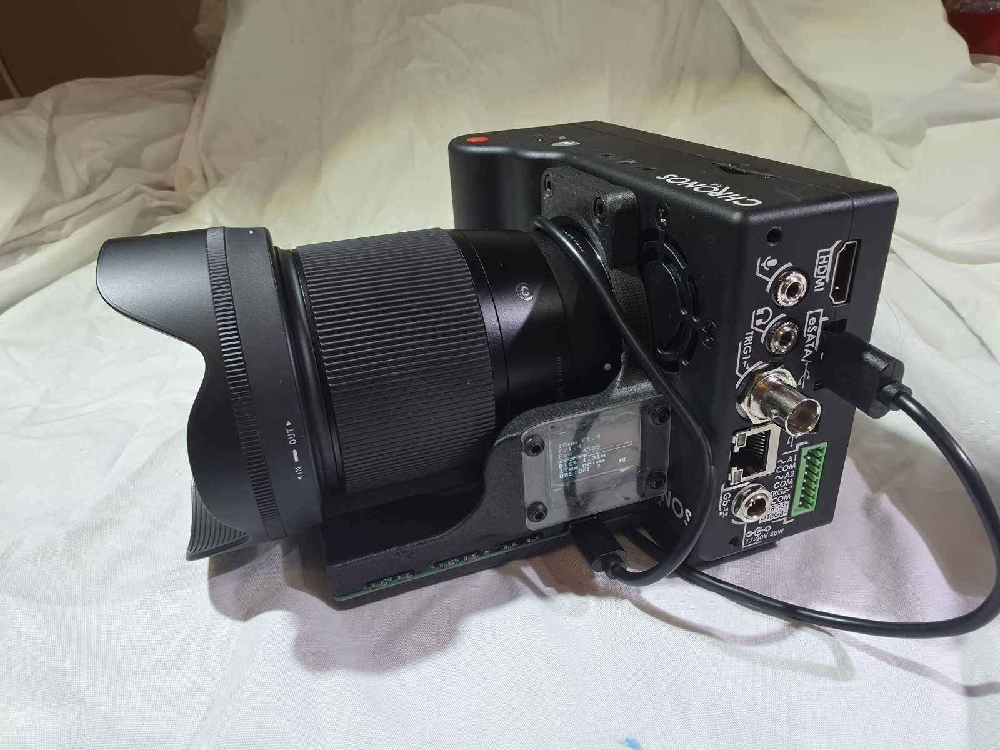
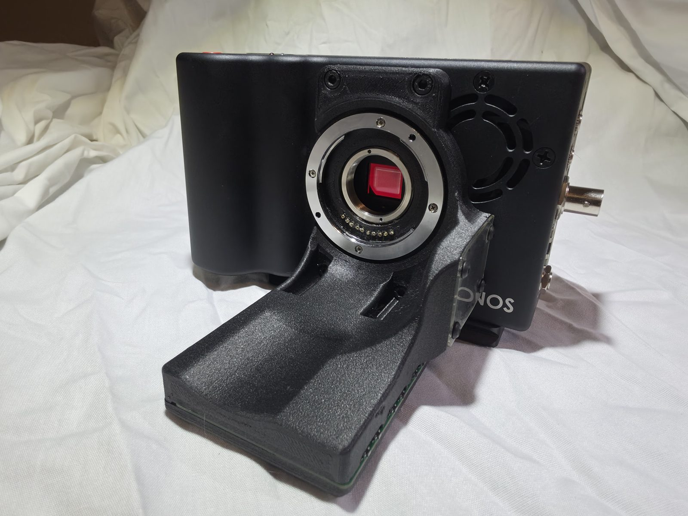
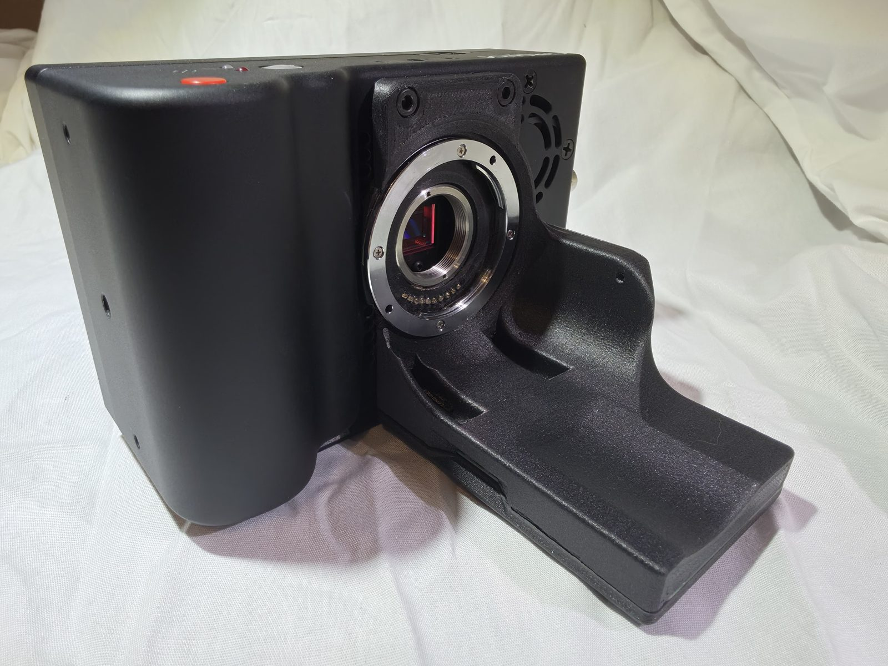
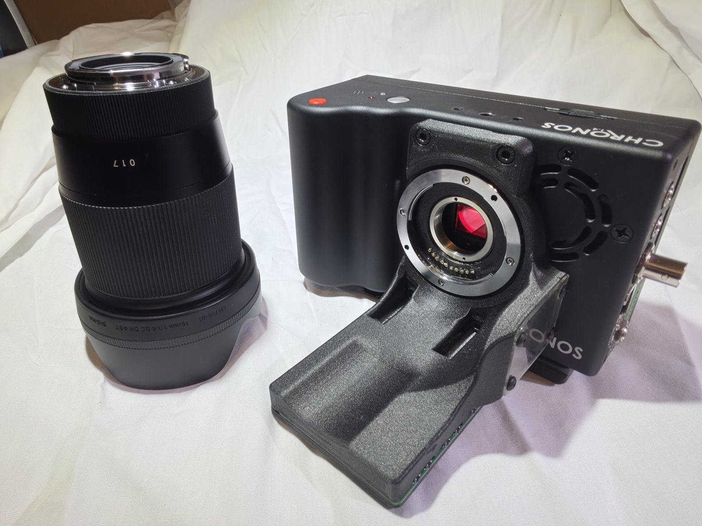
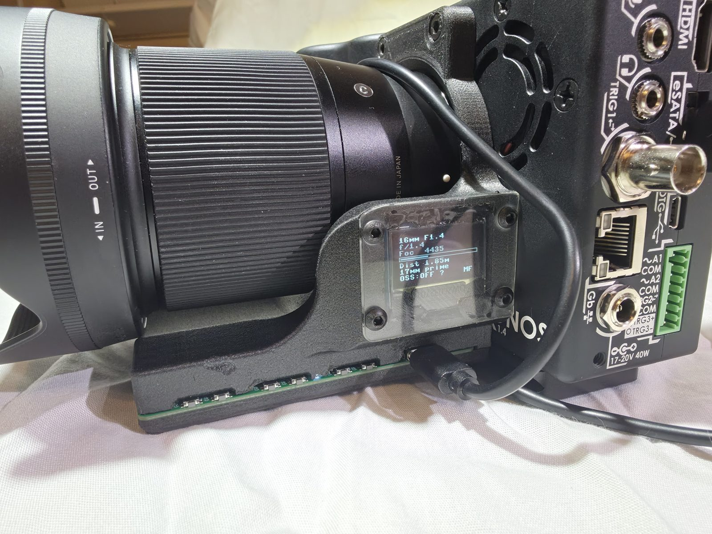
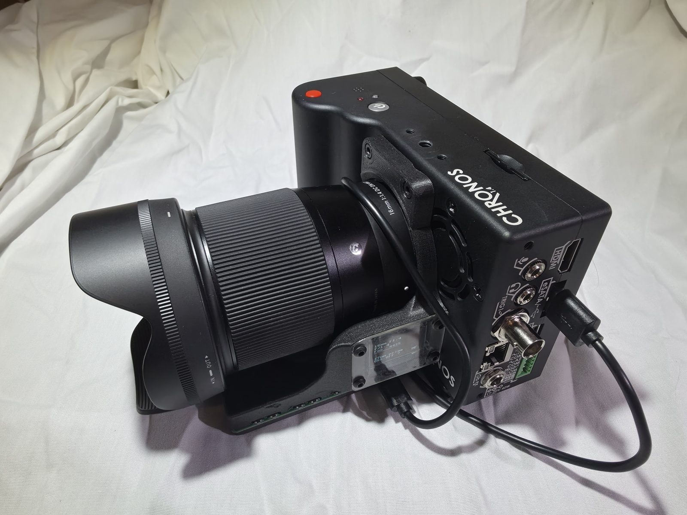
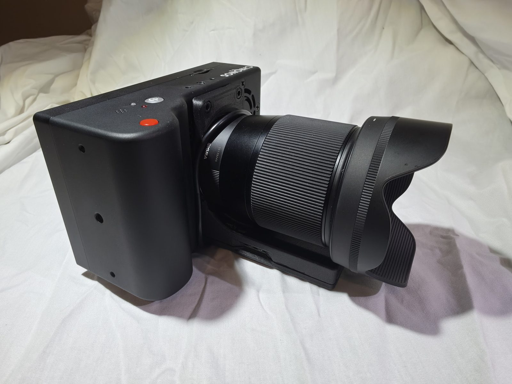

# Chronos E-Mount Lens Adapter

An active Sony E-mount lens adapter for the **Kron Technologies Chronos 1.4 and Chronos 2.1** high-speed cameras.

The adapter bolts to the front of the Chronos body and gives it a working female E-mount with full electronic control of the lens. A small RP2040 control board pretends to be a Sony camera body: it powers the lens, runs the E-mount serial protocol, and lets you drive **aperture and focus from buttons**, with live lens status shown on an OLED screen.



---

## Contents

- [Features](#features)
- [Photos](#photos)
- [What's needed to build](#whats-needed-to-build)
- [Manufacturing the PCBs](#manufacturing-the-pcbs)
- [Repository layout](#repository-layout)
- [Architecture](#architecture)
- [Firmware](#firmware)
- [Sourcing the mount: dismantling a Meike extension tube](#sourcing-the-mount-dismantling-a-meike-extension-tube)
- [Printing the parts](#printing-the-parts)
- [Lens contacts: the weakest part of the design](#lens-contacts-the-weakest-part-of-the-design)
- [Assembly overview](#assembly-overview)
- [Known issues and limitations](#known-issues-and-limitations)

---

## Features

- Female Sony E-mount on Chronos 1.4 / 2.1 bodies, with correct back focus
- Full electronic lens control. The board acts as the camera body on the E-mount bus.
- **Aperture** open/close in 1/3-stop steps
- **Focus**, either by the lens's own focus ring (focus-by-wire passthrough) or by buttons with a smooth speed ramp
- **Graceful eject**: the lens parks itself and powers down before you remove it
- **Hot-unplug safe**: removing the lens cuts power at once, from an interrupt
- 128×64 OLED status display showing lens name, focal length, f-number, focus position and distance
- Powered over USB-C from the camera's own USB port

## Photos

| | |
|---|---|
|  |  |
| Mount face with the lens off. The bayonet ring and lugs come from a Meike extension tube. | The row of lens contact springs sits just inside the bayonet. |
|  |  |
| Lens off, ready to mount. | Status display: lens, f-number, focus position, distance, OSS and focus mode. |
|  |  |
| The USB-C cable runs from the control board to the Chronos USB port. | Grip side. The adapter keeps a low profile under the lens. |

## What's needed to build

This is a personal project, and not intended to be a product. 

Everything needed to build one is in this repo apart from a few bought parts and tools.

The adapter consists **two 3D-printed parts and two PCBs**, plus parts harvested from a Meike E-mount extension tube set.

it is a fairly simple build, but does require a 3d printer, some high precision soldering, and handling of very tiny parts.

| Part | Type | Description |
|---|---|---|
| Adapter plate | 3D print | Bolts to the Chronos front, carries the E-mount bayonet and the contact flex, and sets the back focus |
| Cover | 3D print | Encloses the control board and holds the OLED window and buttons |
| E-mount interface (`EMountIface`) | Flat-flex PCB | Carries the lens contact springs and connects them to the control board |
| Control board | PCB | RP2040 lens controller, power switching, buttons, USB-C |
| [SSD1306 0.96" 128×64 I²C OLED module](https://a.co/d/0h7kQ9I0) | Bought part | Status display. It plugs into the control board's 4-pin header (address `0x3C`). |
| 1×10 pin header, 2.54 mm pitch | Bought part | Joins the flat flex to the control board (see below) |
| [Meike E-mount auto-focus extension tube set](https://a.co/d/0dT2TBgD) | Donor part | One tube provides the bayonet lugs, the tension springs and the electrical contact springs. The second tube is kept whole as a test fixture for setting the contacts. |
| USB-C cable | Bought part | Powers the control board from the Chronos USB port |

### Connecting the flat flex to the control board

The flat flex and the control board each have a matching row of ten 2.54 mm through-hole pads (Würth 61301011121 footprint). They are joined with a short piece of **1×10 straight pin header**:

1. Solder the pin header into the flat flex pcb.
2. Slide the flat-flex tail over the main control board so that pin 1 lines up on both boards.
3. Solder the the pins to the main control board, and trim off the excess pin length.

This makes a permanent, low-profile joint. To take the adapter apart later you'll need to desolder it, so finish the contact setup (see [Lens contacts](#lens-contacts-the-weakest-part-of-the-design)) before you solder it in for good.

### Control board hardware

- **RP2040** MCU with 16 MB W25Q128 QSPI flash and a 12 MHz crystal
- **USB-C** input (power and MicroPython REPL), with an NCP1117 3.3 V regulator
- Two P-MOSFET high-side switches: one for **lens logic power (3.3 V)** and one for **lens motor power (5 V)**
- 1812 PTC fuse on the input
- 10-pin header footprint (J2) for the E-mount flat flex
- 4-pin header for the **SSD1306 128×64 OLED** module (I²C)
- 6 side-actuated buttons: aperture open/close, focus down/up, OSS toggle, eject
- LIS3DH accelerometer (not used by the firmware; can be left off to allow JLCPCB's Economic assembly)

## Manufacturing the PCBs

Both boards were made by **[JLCPCB](https://jlcpcb.com)** from the design files in `hardware/pcbs/`. Almost everything is left at JLCPCB's default settings; the exceptions are listed below.

### Control board

Upload `hardware/pcbs/control_board_CAM_Output.zip` (the Gerbers and drill file exported from Fusion Electronics) to JLCPCB's PCB quote page.

- **PCB thickness: 1.0 mm.** This is the only setting to change. Everything else (2-layer FR-4, finish, colour and so on) can stay at JLCPCB's defaults, it would look better as black solder mask, but I wasn't going to wait the extra 2 days.
- **Assembly: turn on PCB Assembly** and export a BOM and pick-and-place (CPL) file from `control_board.sch` / `control board.brd` for it. The RP2040 (QFN-56) and the other fine-pitch parts are much easier to have assembled than to solder by hand.
- **Standard vs Economic assembly:** as designed, the board has to go through JLCPCB's **Standard** assembly service, because the LIS3DH accelerometer can't be placed on the Economic line. The firmware doesn't use the accelerometer, so if you mark it as **do not populate** (remove it from the BOM/CPL), you can choose the cheaper **Economic** service instead.
- Hand-solder the through-hole headers (flat flex and OLED) after the boards arrive.

### E-mount interface (flat flex)

- Order `EMountIface.brd` as a **flex PCB** from JLCPCB, exporting its Gerbers from Fusion Electronics in the same way as for the control board.
- **All default settings, no stiffener.**
- The flex has no components on it apart from the hand-soldered contact springs and the pin header joint, so it doesn't need assembly.

## Repository layout

```
firmware/
  main.py                  MicroPython lens driver (copy to the RP2040)
hardware/
  mechanical/              Fusion 360 (.f3d) and STEP models
    adapter plate.*          printed part
    cover.*                  printed part
    control board.*          PCB model, for fit checks
    EMountIface.*            flat-flex PCB model, for fit checks
  pcbs/                    Eagle / Fusion Electronics schematics and boards
    control_board.sch / control board.brd
    EMountIface.sch / EMountIface.brd
    control_board_CAM_Output.zip   Gerbers for the control board
pictures/                  Full-resolution build photos
```

## Architecture

```
 ┌──────────────┐  USB-C (5 V)  ┌────────────────────────────────────────┐
 │  Chronos     │──────────────▶│ Control board                          │
 │  USB port    │               │                                        │
 └──────────────┘               │  RP2040 ── I²C ── SSD1306 OLED         │
                                │    │  └── GPIO ── 6 buttons            │
                                │    │                                   │
                                │    ├─ GP6 ─▶ Q2 ─▶ LOGIC_VCC (3.3 V)   │
                                │    ├─ GP7 ─▶ Q3 ─▶ LENS_PWR  (5 V)     │
                                │    ├─ UART0 TX/RX ─┐                   │
                                │    ├─ B_CS / L_CS ─┤ E-mount bus       │
                                │    ├─ VD (60 Hz) ──┤                   │
                                │    └─ LENS_DET ◀───┘                   │
                                └──────────────────┬─────────────────────┘
                                                   │ 10-pin connector
                                        ┌──────────▼──────────┐
                                        │ EMountIface flat    │
                                        │ flex + contact      │
                                        │ springs             │
                                        └──────────┬──────────┘
                                                   │ ~2 mm air gap
                                        ┌──────────▼──────────┐
                                        │  Sony E-mount lens  │
                                        └─────────────────────┘
```

The control board stands in for a Sony body. The E-mount bus carries:

| Signal | Direction | Purpose |
|---|---|---|
| `B_TO_L_TXD` / `L_TO_B_RXD` | body ↔ lens | Half-duplex-style UART, 750 kbaud at start-up, then up to 1.5 Mbaud |
| `B_CS_L` / `L_CS_B` | body → lens / lens → body | Chip-select handshake lines that frame each exchange |
| `BODY_VD_LENS` | body → lens | 60 Hz vertical-sync pulse. The lens runs its control loop in step with it. |
| `LENS_DET` | lens → body | Pulled low when a lens is mounted |
| `LENS_PWR`, `LOGIC_VCC` | body → lens | Switched 5 V motor supply and 3.3 V logic supply |

### RP2040 pin map

| GPIO | Function |
|---|---|
| GP0 / GP1 | UART0 TX / RX to the lens |
| GP2 / GP3 | `L_CS_B` (in) / `B_CS_L` (out) |
| GP4 | `LENS_DET` (low = lens attached) |
| GP5 | `BODY_VD_LENS` 60 Hz sync (PWM) |
| GP6 | Lens logic power enable (low = on) |
| GP7 | Lens motor power enable (driven low = on, input = off; **never drive high**) |
| GP8 / GP9 | Aperture open / close buttons |
| GP10 / GP11 | OLED SDA / SCL (I2C1) |
| GP12 / GP13 | Focus down / up buttons |
| GP14 | OSS toggle button |
| GP15 | Eject button |
| GP16–21 | LIS3DH accelerometer (SPI, unused) |

## Firmware

The firmware is a single MicroPython file, [`firmware/main.py`](firmware/main.py). Flash MicroPython onto the RP2040, then copy `main.py` to the board, for example with Thonny or `mpremote cp firmware/main.py :main.py`. It runs at boot.

### State machine

```
  no lens ──(LENS_DET low, 150 ms debounce)──▶ power on
     ▲                                             │
     │                                     pin handshake
     │                                             │
     │                                             ▼
     │                                     init sequence ──(fail)──▶ error ─(1 s)─┐
     │                                             │                              │
     │                                             ▼                              │
     │                                  60 Hz run loop ◀───────────────────────────┘
     │                                             │
     ├──────────(lens pulled: hard IRQ cuts power)─┤
     │                                             │
     └──(lens removed)── ejected ◀──(EJECT button: graceful shutdown)
```

1. **Detect and power up.** When `LENS_DET` stays low for 150 ms, the board switches on the lens logic and motor supplies, starts the 60 Hz VD signal, and opens the UART at 750 kbaud.
2. **Pin handshake.** The lens signals it is ready by pulling RXD low and raising `L_CS`. The board answers by raising and then dropping `B_CS`. This sequence was measured on a real lens, and the firmware follows it.
3. **Init sequence.** The board sends the same set of messages a Sony A6000 sends: `0x01, 0x07, 0x0C, 0x0B, 0x08, 0x09, 0x0D, 0x10, 0x0A`. Along the way it reads the lens ID, focal-length range and aperture range, and it switches the bus to 1.5 Mbaud if the lens supports it (`0x0C`). It aborts on the same conditions a real body does.
4. **Run loop.** Each frame the lens sends status messages (`0x05`, `0x06`), and the board answers with control messages (`0x03`, `0x04`):
   - `0x03` carries the requested aperture, in 1/3-stop steps, and the data-row index the body wants back.
   - `0x04` carries the focus command. By default it sends **"focus follow"** (`0x81`), which hands focus to the lens's own focus ring. While a focus button is held, it switches to absolute move commands with a speed ramp (crawl to full speed over about 1 s), then stops and hands control back to the ring.
5. **Eject.** Pressing EJECT follows the power-off sequence of a Sony body: send `0x0A` with an all-zero payload, then `0x16`, and wait for the lens to park and acknowledge. The board then cuts motor power, drops `B_CS`, waits for RXD to fall, and cuts logic power. The lens stays off until it is removed or EJECT is pressed again.
6. **Hot unplug.** A hard interrupt on `LENS_DET` going high switches off both supplies and tri-states the bus lines straight away, using register writes only, so an unpowered lens is never back-fed.

### Design notes

- **Non-blocking display.** The OLED is updated one 128-byte page at a time between lens frames, so drawing the screen never makes the lens loop miss a frame.
- **Allocation-free hot paths.** RX and TX use preallocated buffers and `memoryview`s to keep the garbage collector out of the 60 Hz loop.
- **Tunables** at the top of `main.py` cover baud rate limits, timeouts, focus speed and ramp, aperture button repeat rate, I²C speed and debug logging.
- **Diagnostics.** Setting `PIN_HS_TRACE = True` logs every handshake line change with microsecond timestamps. This is useful for checking a new lens.

### Protocol sources

The protocol work builds on community reverse-engineering of the Sony E-mount bus, including the *E-mount protocol RE* notes, the LexOptical E-Mount firmware and traffic captures, and our own captures and measurements on a Sony SELP1650.

### Tested lenses

| Lens | Status |
|---|---|
| Sony E PZ 16-50mm f/3.5-5.6 OSS (SELP1650) | Working |
| Sony E 55-210mm f/4.5-6.3 OSS (SEL55210) | Working |
| Sigma 16mm F1.4 DC DN, model 402965 (shown in the photos) | Working |
| Sigma 30mm F1.4 DC DN, model 302965 | Working |

If you try another lens, please open an issue with the result. A `PIN_HS_TRACE` log helps if it fails.

## Sourcing the mount: dismantling a Meike extension tube

Rather than machining a bayonet, this design takes the precision metal parts from an inexpensive **[Meike E-mount auto-focus extension tube](https://a.co/d/0dT2TBgD)**. The tube's lens-side (female) end already contains everything a body-side E-mount needs:

- the **bayonet ring with its lugs**, which carries the lens's weight and clocking
- the **tension (leaf) springs** on the back of the ring, which pull the lens flange tight against the mount face
- the **electrical contact springs**, which touch the lens's gold pads

The tube also has a lock pin and release lever, but this build doesn't use them (see [Why there is no lock pin](#why-there-is-no-lock-pin)).

### Teardown

1. **Pick one tube to dismantle.** The Meike set comes with two tubes. Take one apart for parts and **keep the other one whole**: it is used as a stand-in lens when you set the contacts.
2. **Remove the front-face screws.** The female mount face is held by four M2 countersunk screws on a 52 mm bolt circle. Use a good-fitting JIS/Phillips #0 driver. The screws are small and strip easily.
3. **Lift off the bayonet ring.** Take care to keep the **leaf tension springs** on its back face. These are what keep the lens seated with no play, so don't bend them.
4. **Remove the contact block** and free the **contact springs** from it. These are the parts that touch the lens pads, and they get soldered onto the flat-flex PCB later.
5. Keep all the screws. The bayonet ring goes back together on the printed adapter plate using the same screws and hole pattern. The lock pin and release lever can be set aside.

The adapter plate copies the hole pattern and clocking of the Meike mount face, so the harvested ring and screws drop straight in.

### Why there is no lock pin

On a normal E-mount body (and in the extension tube), a spring-loaded pin pops up into a notch in the lens flange once the lens is rotated home. That stops the lens from turning back out until you press the release button. The pin needs a few millimetres of depth behind the mount face for its own travel and its spring.

Here there is only about 2 mm between the mount ring and the Chronos body (see [Lens contacts](#lens-contacts-the-weakest-part-of-the-design)), and the contact flex already takes up most of it. There isn't enough throw for the pin to retract fully when the lens is turning and then spring out far enough to catch, so I couldn't get it to work reliably and left it out.

Without the pin, the lens is held by the bayonet lugs and the leaf-spring tension. In practice this is plenty: focusing and normal handling don't move the lens. Just rotate the lens fully home when mounting, and don't carry the camera by the lens.

## Printing the parts

There are two printed parts: the **adapter plate** and the **cover**. STEP files are in `hardware/mechanical/`.

**Recommended material: carbon-fiber-reinforced polycarbonate (PC-CF).**

- The adapter plate holds the full weight of the lens and sets the back focus. It has to stay stiff and keep its size, and PC-CF creeps far less than PLA or PETG under constant load.
- The Chronos body gets warm in use, and polycarbonate's high heat-deflection temperature keeps the mount from softening or warping.
- The carbon fill gives a matte, non-reflective finish, which helps keep stray light down around the sensor opening.

**Alternative: carbon-fiber-reinforced PETG (PETG-CF)** may also be a good candidate. It's easier to print than PC-CF (lower temperatures, less warping, and no enclosure needed), and the carbon fill still adds a lot of stiffness. Its heat resistance and creep resistance are lower than PC-CF's, so it is a reasonable choice if you can't print polycarbonate well, but PC-CF is still preferred for the adapter plate.

Print the adapter plate with the mount face flat on the bed for the best flatness. Use a hardened nozzle for CF filaments. Check the back focus after printing; small changes in the plate's thickness show up directly as focus error at infinity.

## Lens contacts:

**The electrical contacts to the lens are the most fragile part of this build.**

The E-mount has a short 18 mm flange distance, and the Chronos sensor sits deep enough that, to get the back focus right, **there is only about a few mm of space between the lens and the Chronos body.** That few mm has to hold the adapter plate's mount face, the flat-flex PCB, and the contact springs. There is no room for an off-the-shelf pogo-pin block or for the extension tube's original contact housing.

The solution was a thin **flat-flex PCB** (`EMountIface`) with the harvested Meike contact springs soldered straight onto it. This is a hand-fitting job:

1. **Solder the springs** onto the pads of the flat-flex PCB, one per E-mount contact.
2. **UV-cure glue** the flex and springs into the slot in the adapter plate so that the springs stand in the correct positions behind the contact window.
3. **Cut the springs short** so they reach just past the mount face. They should touch the lens pads without stopping the lens from rotating into the bayonet.
4. **Bend** each spring so it will press on the center of its pad once a lens is locked in.
5. **Mount the spare Meike tube as if it were a lens.** Its rear (male) end has the same gold contact pads in the same positions as a real lens, and those pads are wired straight through to the contact springs on its front (female) end.
6. **Check each contact with a continuity tester**, from the spring on the front of the spare tube to the matching pin on the 10-pin header. Because the tube's pads sit exactly where a lens's would, a good reading proves that each spring is touching the *right* pad with real pressure, not just touching something. Also check that no pin is shorted to its neighbours.
7. Remove the tube, re-bend any spring that failed, and repeat until every contact passes.

Using the spare tube instead of a real lens means you're not probing, or scratching, the contacts of an expensive lens, and the probe points on the tube's front face are easy to reach. Expect to iterate on steps 3–7 several times. If the lens fails to initialise, or drops out intermittently, check these contacts first. A spring that is slightly too short gives intermittent connection, and one that is too long can snag the lens pads when mounting.


## Assembly overview

1. Print the adapter plate and cover in PC-CF (or PETG-CF).
2. Order the control board and the `EMountIface` flat flex from JLCPCB (see [Manufacturing the PCBs](#manufacturing-the-pcbs)).
3. Dismantle one Meike extension tube as described above, and keep the second one whole.
4. Install the bayonet ring and leaf springs on the adapter plate with the original M2 screws. The lock pin is not used.
5. Fit the contact springs to the flat flex, glue it into the adapter plate, and set the springs using the spare tube (see [Lens contacts](#lens-contacts-the-weakest-part-of-the-design)).
6. Join the flat flex to the control board with the 1×10 pin header, then mount the board and the SSD1306 OLED in the cover.
7. Flash MicroPython and `firmware/main.py`.
8. Mount the adapter on the Chronos and connect the control board to the camera's USB port with a USB-C cable.
9. Mount a lens. The OLED should show the lens name and f-number within a second or two.

## Known issues and limitations

- **Lens contacts** are hand-fitted and are the most likely point of failure (see above).
- **No lens lock pin.** The lens is held by the bayonet and leaf springs only (see [Why there is no lock pin](#why-there-is-no-lock-pin)).
- **OSS (image stabilisation) and power-zoom** are not controllable. No OSS on/off or zoom command has been found in any public protocol source. The OSS button toggles a placeholder (`OSS_FIELD = None`) until the field is found.
- **Lens power switch rework.** On the current control board, R11 must be removed so that Q3 (lens motor power) can actually turn off. GP7 then connects straight to a gate that R10 pulls up to 5 V, which is outside the RP2040's rating. A planned fix replaces R16 with a BAT54 Schottky diode (cathode to GP7). The firmware never drives GP7 high, and must not.
- **No external pull-up on `L_TO_B_RXD`.** The firmware uses the RP2040's internal pull-up. A 10–47 kΩ external pull-up is recommended on the next board revision.
- Four lenses have been tested so far (see [Tested lenses](#tested-lenses)). Others should work but are unconfirmed.

---

*Not affiliated with Sony, Kron Technologies or Meike. E-mount is a trademark of Sony Corporation.*

*Huge Thanks To LexOptical, without the e mount traffic samples and reverse engineering repos, this would not have been possible*

*mechanical and electrical design beyond the e mount itself is my own, Firmware and docs were made with heavy assistance from Claude*
